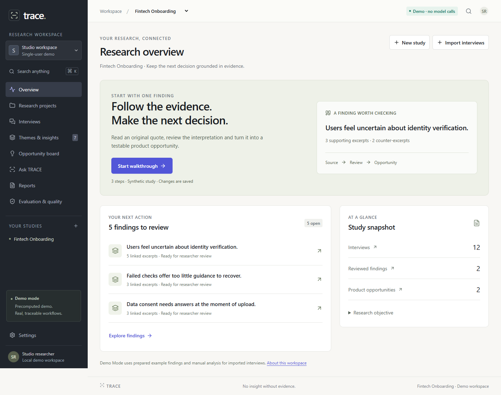

# TRACE — AI Research Copilot

### From customer conversations to confident product decisions.

An evidence-first qualitative research workspace for UX researchers, product managers and product/business analysts. Follow a finding back to the exact conversation that supports it, preserve contradictory feedback, and turn reviewed research into a testable product opportunity.

**This release runs in free Demo Mode.** Its fintech research is synthetic and its seeded findings are precomputed. Imported interviews have a complete manual research workflow. No paid API, account provisioning or external model transmission is required. Live LLM extraction and synthesis are not implemented in this build.



## Try the defining workflow

1. Select **Try the example study** on first launch, then **Start walkthrough** on the overview.
2. **Read the source.** Open the highlighted original quote and inspect the surrounding conversation. Select **Continue to review** beside the passage.
3. **Review the finding.** Compare supporting and contradictory excerpts, edit or flag the interpretation if needed, then verify it after review.
4. **Create an opportunity.** Turn the reviewed finding into a hypothesis and add a validation plan before saving.
5. Finish the walkthrough to return to your review queue. Generate a report from **Reports**, then edit and export Markdown or print to PDF.

The three-step walkthrough follows actual source navigation and saved research states. Progress survives reloads in the same browser. You can exit at any time; completed walkthroughs give way to the regular review queue and can be replayed. The overview keeps detailed analysis in its dedicated views instead of duplicating charts and activity feeds. Reading text is 15–17 px, with secondary labels at least 12 px on screen.

Changes persist in the database across reloads. Editing an interpretation or its source links returns it to review.

## Run locally

Use Node.js **24 or later** and npm. Node's SQLite driver is required. Windows, macOS and Linux are supported by the source; the validation notes record what was exercised in the implementation environment.

On Windows, after installing Node.js, you can double-click **START-TRACE.cmd**. It installs missing dependencies, applies local migrations, starts the app and opens the default browser after a successful readiness check. The terminal commands below provide the same workflow.

```sh
npm ci
npm run db:migrate
npm run dev
```

Open **http://127.0.0.1:5173**, then select **Try the example study**. To seed from another terminal while the app is running:

```sh
npm run db:seed
```

Seeding refuses to overwrite any workspace that already contains a project. It does not silently reset imported research.

For a local production build:

```sh
npm run build
npm start
```

The default SQLite file is `.trace-data/trace.sqlite`, excluded from version control and source archives. `.env.example` documents optional local settings. Next.js can read `.env.local`; CLI helpers also accept environment variables. Do not commit a research database or exported research backup to a public repository.

On restricted Windows environments, the included Babel configuration and narrow realpath fallback support the local build tools. They do not grant additional filesystem permissions. If port 5173 is occupied, stop the previous TRACE process before starting another.

## Working capabilities

| Workspace area    | Implemented behavior                                                                                                                                                                            |
| ----------------- | ----------------------------------------------------------------------------------------------------------------------------------------------------------------------------------------------- |
| Overview          | Guided source-to-opportunity walkthrough, actionable review queue, compact study snapshot and expandable research objective                                                                     |
| Studies           | Create, edit, open, archive and restore, with research objectives and methodology                                                                                                               |
| Interviews        | Paste or upload TXT/MD/CSV, validate batches, detect duplicate transcripts, preserve source segments and offsets                                                                                |
| Transcript reader | Search, exact source highlighting, quotation selection, full-response saving, metadata/tags/notes editing                                                                                       |
| Evidence          | Literal quotation checks, manual classification and theme linking, source deep links                                                                                                            |
| Themes & insights | Theme/library/evidence/comparison views, search and filters, sourced insight creation, editing, verification, rejection, weak-claim flagging, evidence attachment/removal and duplicate merging |
| Opportunity board | Kanban and table views, drag/drop or status menu, create/edit, filters, estimated prioritization, linked insights and their sources                                                             |
| Ask TRACE         | Local keyword retrieval over stored findings with quotes, limitations, counter-evidence notices and insufficient-evidence responses                                                             |
| Reports           | Verified-finding report generation, Markdown editing/export, human-readable source appendix and print styles                                                                                    |
| Quality           | Computed citation/exactness checks, annotated demo consistency metrics, reference-case inspection and run history                                                                               |
| Settings          | Transparent mode/data information, keyboard help and archival JSON export                                                                                                                       |

Research data stays in the local/private database. Every quote is addressable; every new opportunity link requires a verified insight. Qualitative interview counts always retain their sample context.

## Import format

Supported inputs: pasted text, `.txt`, `.md`, and `.csv`. PDF, DOCX and audio are not supported. Files are limited to 2 MB; transcript fields to 200,000 characters; CSV batches to 50 interviews.

Required CSV headers:

```csv
title,participant,segment,date,transcript
"Example interview","P13","New customer","2026-10-14","Researcher: What happened after submitting your document?
P13: I was not sure it had arrived, so I waited for confirmation before continuing."
```

Optional columns: `tags`, `notes`, `objective`. Use YYYY-MM-DD dates. Quote fields containing commas or newlines, and double embedded quotation marks. The import dialog provides a downloadable example. A malformed or duplicate record rejects the entire batch.

## Stack and source layout

- Next.js App Router, React and strict TypeScript for the local application.
- Vinext/Vite and the Sites Worker integration for hosted deployment.
- SQLite locally; Cloudflare D1 for the private hosted workspace.
- Drizzle schema and versioned SQL migrations; parameterized SQL domain commands.
- Zod input validation; Lucide icons; custom responsive CSS with Tailwind available.
- Vitest, real SQLite integration tests and Playwright browser scenarios.

```text
app/                      App shell entry, styles and JSON API
components/               Research workspace features and shared UI
lib/actions.ts            Validated mutations and review transitions
lib/ingestion.ts           Segmentation, CSV parser and exact-quote checks
lib/research.ts            Source traversal, retrieval, evaluation and reports
lib/repository.ts          Relational reads, inserts and atomic seed
lib/database.ts            Local Node SQLite adapter
lib/database-cloudflare.ts Hosted D1 adapter, selected by the Vite build
lib/seed.ts                Authored synthetic corpus and precomputed findings
db/schema.ts              Fourteen-table Drizzle schema
drizzle/                  Generated, versioned SQL migrations
scripts/                  Startup, migration, seed and evaluation commands
tests/                    Unit, SQLite integration and browser workflows
docs/                     Architecture, evaluation, screenshots and case study
```

See the [architecture and ER diagram](docs/architecture.md), [evaluation and event definitions](docs/evaluation.md), and [English portfolio case study](docs/portfolio-case-study.md).

## Evidence reliability

Original wording and UTF-16 character offsets are preserved. Speaker labels and timestamps are parsed only when present. Quotations must match a real segment literally. Insight links cannot cross studies. Source links remain inspectable through review, opportunities and exports.

These are source-integrity guarantees, not proof of the interpretation. A source-exact quote can still be used to support an overbroad claim. The UI separates interpretation, counter-evidence and limitations, and requires researcher review before a finding can ground a new opportunity.

## Testing and evaluation

```sh
npm run typecheck
npm test
npm run evaluate
```

Browser tests start an isolated local server and a separate temporary SQLite database:

```sh
npx playwright install chromium
npm run test:e2e
```

If Chromium is already installed elsewhere, `TRACE_BROWSER_PATH` can point to its executable. Browser scenarios cover the signature workflow, import-to-insight persistence, search, insufficient-evidence handling and viewport overflow at 1440/1280/1024/768/390 px. Screenshots are written to `docs/screenshots/`.

The seed has 12 synthetic interviews, 144 segments, 18 curated excerpts, six themes, seven insights and two candidate opportunities. Its annotations also generate its precomputed outputs: evaluation is a reproducible consistency benchmark, **not independent model accuracy**. Real-world extraction precision, recall and semantic claim support remain unmeasured. No traction, revenue, customer validation or product uplift is claimed.

## Hosted build

```sh
npm run build:worker
```

This produces `dist/` with the Worker, browser assets and schema migrations for Sites. `.openai/hosting.json` declares the `DB` binding. Hosted migrations and database records are separate from the local SQLite file. Publication must use the selected owner's Sites project and private access configuration; do not publish a clone into someone else's project ID. A sanitized downloadable source archive omits the original hosting identity.

The local Workers emulator failed to start in the implementation's restricted Windows sandbox. The standard Next.js local runtime is provided independently. A successful build alone does not confirm a hosted deployment; use the deployment result and validation notes.

## Limits and roadmap

This is a single-user MVP. Local startup binds to loopback; hosted access relies on platform owner-private controls. There is no application-level team authorization or multi-user collaboration. Workspace reads load the corpus as a whole and need pagination before large-scale use.

No live LLM provider, automatic synthesis of imports, embedding-based retrieval, audio transcription, PDF/DOCX ingestion, independently validated theme scoring, backup restore UI or server-generated PDF is included. Edited reports can introduce unsupported prose and must be reviewed before sharing. Drag/drop has a status-menu alternative, but formal WCAG conformance and assistive-technology usability studies have not been completed.

Next steps: independent annotations and a held-out evaluation set; opt-in server-side Live AI extraction with strict schemas and source rejection; semantic retrieval; pagination; team authorization; accessibility testing with representative users; reliable document import and export.

**No insight without evidence.**
