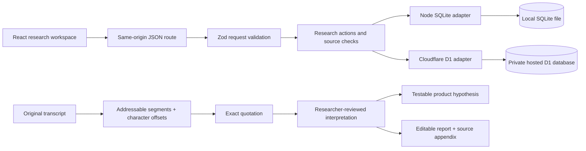
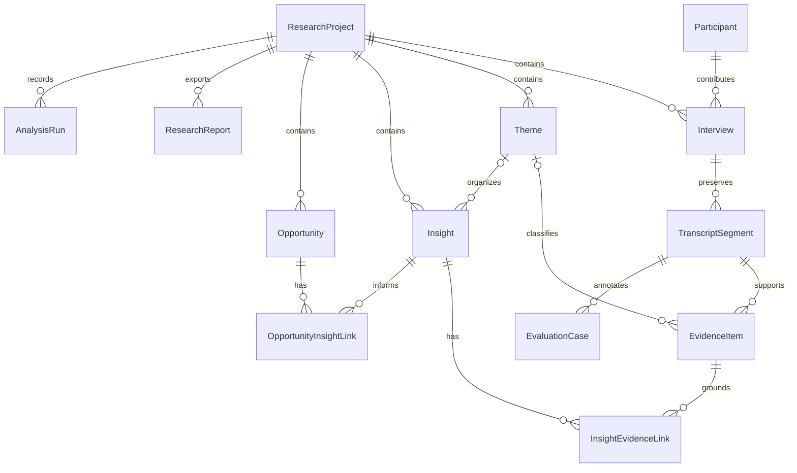

# TRACE architecture

TRACE is a single-user research application with one shared domain layer and two database adapters.

## Runtime choices

- Local: Next.js App Router, React, TypeScript, Node's SQLite driver. `lib/database.ts` exposes a small D1-compatible interface so the domain actions execute the same parameterized SQL in both environments.
- Hosted: Vinext's App Router implementation, Vite, Cloudflare Worker and D1. A build hook substitutes `lib/database-cloudflare.ts` for the local database module. A bundle check rejects local SQLite code in the Worker output.
- Schema: Drizzle declarations and generated, versioned SQL migrations. Application reads do not create tables. Local migration scripts record applied filenames; hosted migrations are packaged with the deployment.
- Mutations: validated JSON commands, atomic database batches, foreign keys, cross-project checks, and review event records. No arbitrary SQL or table names are accepted from the browser.
- UI: a persistent application shell with hash-addressable research views. Source routes retain interview and segment identifiers. Browser storage holds the selected study preference only; research lives in the database.

## Entity relationship diagram

`ResearcherReview` is an append-only action log with a polymorphic entity identifier, action, note and UTC time. Entity IDs are intentionally retained when findings are merged or rejected. It is a basic review history, not a tamper-evident compliance audit log.

## Evidence invariants

1. Segment text is an exact slice of the original transcript. Offsets use JavaScript UTF-16 string indices, with end offsets exclusive. Original CRLF characters are preserved in the stored transcript.
2. Speaker names and timestamps are parsed only from explicit labels. Unlabeled lines remain unlabeled.
3. New quotations must match an existing segment literally and contain at least eight characters.
4. An insight's evidence and theme must belong to its own project.
5. Verification requires at least one exact supporting source. This is a necessary source check, not proof that the interpretation is justified.
6. Editing an interpretation or its evidence links returns it to Under Review.
7. New insight-to-opportunity links require a verified insight. If a previously linked insight changes, the opportunity retains the link and shows its current review state.
8. Archived projects preserve all records and reject research mutations until restored.

## Demo analysis pipeline

The seed contains 12 authored synthetic transcripts, 144 persistent segments, 18 curated quotations, six themes, seven interpretations and two candidate opportunities. Findings were authored with the dataset; they are not model responses. Two seeded Verified states demonstrate the workflow and are identified as seeded demonstration review events.

Import runs validation and segmentation. In Demo Mode, a researcher manually saves quotations, classifies evidence and authors findings. The Validate sources command checks source existence and literal matching and records a local run. It does not perform automatic qualitative extraction or synthesis.

Ask TRACE performs keyword retrieval over stored, non-rejected findings and their linked quotes. It returns the stored interpretations with citations, counter-evidence notices and limitations, or an insufficient-evidence response. It is neither a generative conversation nor semantic RAG.

## Data boundaries

The application does not call an external model, collect real participant identities by default, send emails, or embed remote analytics. Hosted access relies on owner-private platform access controls. Local access is restricted to loopback by the startup command. There is no application-level multi-tenant authorization, team membership system, or shared editing.

Research text is untrusted: React renders it as text; the report reader uses a small text-only Markdown renderer and does not execute HTML. Imports are limited to documented TXT/MD/CSV formats. Server validation limits record and batch sizes. External model integration must add explicit informed transmission, server-only secrets, structured output validation, timeout/retry handling and independent evaluations before Live AI is enabled.

## Known engineering trade-offs

The local Node SQLite adapter is synchronous and intentionally suited to one researcher. The state endpoint loads the workspace as a whole; pagination and incremental retrieval are needed for larger corpora. Report editing is free text and can introduce unsupported claims, so exports require researcher review. PDF output uses the browser print workflow, not a server PDF engine. There is no backup restore UI, transcript rewriting, audio processing or simultaneous collaboration.

The Windows sandbox used for implementation rejected native path canonicalization and the local Workers runtime. A narrow Node realpath fallback and a documented Babel configuration support the local toolchain without altering access permissions. The standard Next.js local runtime is independent of the hosted Workers runtime.
